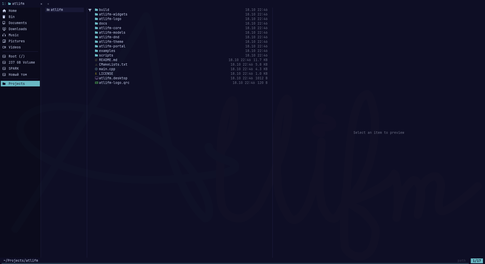

# atlifm

terminal style file manager with human friendly features



why: default file managers on Linux are either GNOME Nautilus with user-friendly macOS-like design with huge paddings and rounded corners, or terminal ones like yazi or ranger, where the philosophy is that keyboard is strictly more important than mouse

atlifm takes terminal aesthetics (multi-pane layout, pseudographics, monospace font, zero animations) while adding mouse controls, drag and drop, tabs and previews

[download v1.0.1](https://github.com/1nfys/atlifm/releases/latest) · [documentation](https://1nfys.github.io/atlifml/docs/welcome) · [downloads guide](https://1nfys.github.io/atlifml/docs/downloads)

---

## features

- **multi-pane layout:** parent folder on the left, current folder in the center, preview on the right, collapses automatically in narrow windows
- **multiple windows:** every launch opens a new independent window (also with a path argument), so a tiling WM tiles them instead of covering each other; each window keeps its own tabs and navigation state
- **mouse interaction:** items open strictly on **double click** (no accidental opening on selection), single click only focuses
- **drag and drop:** drag files into Telegram, Discord, browser, terminal or a graphic editor with a dark badge, Alt+drag opens copy / move / symlink menu
- **top tabs like in neovim/kitty:** shrink dynamically, scroll with mouse wheel, closed with middle click, independent navigation history per tab
- **lag-free preview:** images and SVG with scaling, syntax highlighting for code, directory tree and hex view for binaries
- **video and PDF preview:** video thumbnails via `ffmpegthumbnailer`/`ffmpeg`, scrollable PDF pages via `pdftoppm`, background rendering, disk LRU cache and neighbor prefetch
- **quick filter and global search:** `Ctrl+F` opens the status-bar filter; typed text filters names in the current folder and nested folders. prefix a query with `fd ` to search names on all mounted disks, or `rg ` to search file contents; the command token is highlighted and Esc turns it back into a normal filter
- **network places:** `ftp://`, `ftps://`, `ftpis://`, `sftp://`, `smb://`, `\\\\server\\share`, bare IP and `host:port` addresses open an in-window connection form with protocol, port, path, user, password, SSH key, domain and anonymous mode
- **interactive archives:** browse zip, tar.gz, 7z, rar directly in preview pane, open files or drag them out without full extraction; select entries with a box (drag the left indent / right edge or empty space), toggle with Ctrl+Click, select all with Ctrl+A, extend a range with Shift+Click/Shift+drag, and copy them with Ctrl+C
- **archive extraction and creation:** extract here, extract in and compress in the context menu
- **bulk operations:** multi-select rename, multi-line file/folder creation, trash cleanup and permanent delete
- **properties and disk usage:** Alt+Enter or right click opens inspector with permissions `[ ]`/`[x]`, drive root adds disk usage with progress bars
- **xdg desktop portal:** atlifm can act as the system file picker for browsers and other apps
- **full undo / redo:** Ctrl+Z and Ctrl+Y, pressing Ctrl+Z during a running copy/move cancels it with rollback
- **background tasks:** copy/move/trash/delete/archives run in a task registry with progress, speed, ETA, cancellation and logs; `Alt+W` opens the tasks panel
- **plugins:** custom actions, shortcuts, overrides of built-in operations, preview plugins, hooks, shell scripts and C++ plugins
- **customizable layout:** window size on floating WMs, sidebar and column widths, optional tab bar / bookmarks / status bar / preview, font family and size via `theme.conf`; `Ctrl+Shift+S` persists the current layout, `Ctrl+Shift+R` restores the theme defaults. Tiling WMs keep their tile size and atlifm restores only the panel layout.
- **strict visual style:** no rounded corners, monospace `JetBrainsMono Nerd Font`, selection as row highlight plus status bar counter

---

## shortcuts and hotkeys

| key | action |
| :--- | :--- |
| `↑` / `↓` or `k` / `j` | move cursor |
| `Enter` / `Double Click` / `→` | open file or enter folder |
| `Backspace` / `←` | go to parent folder |
| `Space` | select file and move to next |
| `Ctrl+F` | quick filter by name in the current folder (transient: Enter or Esc resets) |
| `Ctrl+F` → `fd query` | search names on all mounted disks with `fd`; Enter keeps results, Esc turns it into a normal filter |
| `Ctrl+F` → `rg query` | search file contents on all mounted disks with ripgrep; Enter keeps results, Esc turns it into a normal filter |
| `Ctrl+F` → `<plugin command> query` | run a plugin command defined with `Command = …` |
| `Ctrl+T` / `Ctrl+W` | new tab / close active tab |
| `Ctrl+Tab` / `Ctrl+Shift+Tab` | switch between tabs |
| `Mouse wheel on tab bar` | scroll tabs |
| `Alt+←` / `Alt+→` | back / forward in navigation history |
| `Home` / `End` | first / last item in the current folder |
| `Alt+Space` | Quick Jump menu |
| `Ctrl+Return` | open selected folder (or current folder) in a new tab |
| `Middle mouse button` | open folder in a new tab; on a tab it closes the tab; on a bookmark opens it in a new tab |
| `Ctrl+B` / `F9` | toggle bookmarks sidebar on the left |
| `F2` | inline rename; on multi-selection opens the in-window bulk rename overlay |
| `Ctrl+C` / `Ctrl+X` / `Ctrl+V` | copy / cut / paste |
| `Ctrl+Z` / `Ctrl+Y` | undo / redo file operations |
| `Delete` / `Shift+Delete` | move to trash / delete permanently |
| `Ctrl+Shift+N` | create new folder |
| `Ctrl+Shift+A` | create multiple files / folders (one name per line) |
| `Ctrl+Alt+N` | create new empty file |
| `Alt+Enter` | file properties and permissions |
| `Ctrl+Alt+X` | extract archive here (Extract Here) |
| `Alt+W` | background tasks: progress, cancel (`Del`), log (`Enter`) |
| `Ctrl+Shift+S` / `Ctrl+Shift+R` | save the current layout / reset it to `theme.conf` defaults |
| `Ctrl+Q` | quit manager |

### network connections

paste a network address into the address bar (`Ctrl+L`) and press Enter. atlifm opens an in-window connection form instead of a system dialog:

| address | protocol |
| :--- | :--- |
| `ftp://server/path` | FTP, default port `21` |
| `ftps://server/path` | FTP over explicit TLS, default port `21` |
| `ftpis://server/path` | FTP over implicit TLS, default port `990` |
| `sftp://user@server/path` | SFTP, default port `22` |
| `smb://server/share/path` | SMB share |
| `\\server\share\folder` | SMB share from a Windows-style UNC path |
| `192.168.1.10` or `192.168.1.10:22` | SFTP by default, protocol is selectable |
| `user@server:2222` | SSH/SFTP with a custom port |

the form exposes protocol, host/IP, port, remote path, username, password, SSH key (SFTP), domain (SMB), anonymous/guest mode and **Remember password**. the host field also accepts `host:port`; an empty port falls back to the protocol default (`22` SFTP, `21` FTP/FTPS, `990` implicit FTPS, `445` SMB), and an empty path works too. passwords are never written to config files; when Remember password is checked, the password is stored in the system keyring through libsecret and filled automatically the next time the same protocol/host/port/user is used. if atlifm is built without libsecret, the checkbox is hidden and credentials stay session-only; storing them also requires a running Secret Service keyring. after mounting, navigation continues through the GVfs FUSE path under `/run/user/<uid>/gvfs`.

for SFTP, the optional **SSH key** field accepts a private key path (`~` is expanded) or opens a file picker with `...`; the password field becomes the key passphrase hint and can be remembered like a normal password. the selected key path is remembered per host/port/user (not the key contents or passphrase) in `~/.config/atlifm/ssh_keys.ini` with owner-only permissions; clear the field to forget it. atlifm does not copy the key: it adds a managed `Include` line to `~/.ssh/config` and keeps the per-host `IdentityFile` entry in `~/.ssh/atlifm/*.conf`. remove that include line and the `~/.ssh/atlifm` directory to revoke it. leave the key field empty to use your existing `~/.ssh/config` and ssh-agent, including `ProxyJump` and other OpenSSH options. the checkbox **Accept unknown SSH host key** only affects SFTP.

network support uses GIO/GVfs. install `gvfs`, `gvfs-fuse` and the backend for the protocol you need (`gvfs-smb` for SMB; SFTP and FTP backends are usually part of `gvfs`). if a backend or `gvfs-fuse` is missing, the connection form shows the error without blocking the rest of the application.

SMB Kerberos/AD, SMB signing and encryption, SMB1, ACL/read-only rights, hidden shares and DFS are handled by the installed GVfs/libsmbclient stack; the form only passes credentials and the share path. FTP active/passive mode, virtual users and server-side read-only rights are negotiated by the FTP backend and server. SFTP OTP/2FA can be entered in the password field for single-prompt flows; SSH certificates, GSSAPI/Kerberos, ssh-agent and ProxyJump work through OpenSSH and `~/.ssh/config`. client TLS certificates for FTPS are not exposed by the current GVfs mount API.

for a quick SFTP check use the public Rebex test server: address `sftp://demo@test.rebex.net/`, password `password`, port `22`. on the first connection enable **Accept unknown SSH host key** in the form; the fingerprint is then trusted and the share opens under `/run/user/<uid>/gvfs`. the checkbox is only shown for SFTP and is off by default.

any key can be rebound in `~/.config/atlifm/keybinds.conf` (created automatically on first launch with all actions and defaults):

```ini
new_tab = Ctrl+T
close_tab = Ctrl+W, Ctrl+F4
quick_jump = Alt+Space   # empty value = action disabled
```

bare `g` and `w` are not used by default: printable keys start type-ahead filtering in the file list, so a global shortcut would steal the first character. old generated configs with `quick_jump = G`, `quick_jump = Alt+G` or `tasks = w` are migrated to `Alt+Space` / `Alt+W` automatically.

full list of action IDs is available in the cheat sheet on F1. if config does not exist, defaults from the table above are used

cheat sheet (F1) opens as an overlay, and bindings can be remapped directly inside it: click key -> press new combination (Backspace to disable, Esc to cancel), right click on key allows resetting to default (`Reset to default`) or disabling. changes are immediately applied and saved to `keybinds.conf`

a shortcut already used by another action is rejected with a conflict message instead of being saved. the same check blocks a reset when the default combination would collide. if `keybinds.conf` is edited by hand, duplicate combinations are skipped at startup with a warning, so one ambiguous binding cannot silently disable both actions.

---

## building

compiler with C++23 support is required

### dependencies

Arch Linux / Manjaro:
```bash
sudo pacman -S base-devel gcc cmake ninja pkgconf qt6-base qt6-svg glib2
```

Fedora / RHEL:
```bash
sudo dnf install gcc-c++ cmake ninja-build pkgconf-pkg-config qt6-qtbase-devel qt6-qtsvg-devel glib2-devel
```

Ubuntu / Debian:
```bash
sudo apt install build-essential cmake ninja-build pkg-config qt6-base-dev qt6-base-private-dev libqt6svg6-dev libglib2.0-dev
```

### optional tools

atlifm works without these; each feature shows a clear fallback when a tool is missing:

| tool | used for |
| :--- | :--- |
| `fd` / `fdfind` | fast file and folder name search |
| `rg` (ripgrep) | content search for `rg query`; falls back to `grep -rIl` |
| `ffmpegthumbnailer` or `ffmpeg` | video thumbnail in the preview pane |
| `poppler-utils` (`pdftoppm`, optional `pdfinfo`) | PDF page rendering and page count |

### compilation

```bash
cmake -B build -G Ninja -DCMAKE_BUILD_TYPE=Release
ninja -C build
```

---

## installation

prebuilt packages for **x86_64** and **aarch64** are attached to every release:

**https://github.com/1nfys/atlifm/releases/latest**

the release page also contains the source tarball and the Debian source package. command examples below use the `1.0.1` artifacts; replace the version with the release you downloaded.

### supported distributions

| distribution | supported releases | package channel |
| :--- | :--- | :--- |
| Arch Linux | rolling | pacman package, PKGBUILD |
| Manjaro | rolling | pacman package |
| Debian | 13 (trixie) and newer | `.deb`, OBS apt repository |
| Ubuntu | 26.04 LTS and newer | PPA, OBS apt repository, `.deb` |
| Fedora | 43-45 | COPR, OBS dnf repository, `.rpm` |
| openSUSE | Tumbleweed (rolling) | OBS zypper repository, `.rpm` |
| RHEL / CentOS Stream | 10 (EPEL 10) | COPR |
| Alpine Linux | 3.22 and newer | `.apk` |
| any glibc distribution | glibc 2.38+ | AppImage |

Debian 12, Ubuntu 24.04 and other older releases ship Qt older than 6.5, which is below the minimum supported version. Use the AppImage (glibc 2.38+) or build from source with Qt 6.5+ on those systems. The AppImage is the only prebuilt option that bundles Qt itself.

### arch linux / manjaro

download the pacman package and install it locally:

```bash
sudo pacman -U atlifm-1.0.1-1-x86_64.pkg.tar.zst
```

or build the `PKGBUILD` from this repository:

```bash
sh packaging/scripts/make-src-tarball.sh . packaging/arch
cd packaging/arch
makepkg -si
```

### debian / ubuntu

ubuntu has a PPA:

```bash
sudo add-apt-repository ppa:1nfys/atlifm
sudo apt update
sudo apt install atlifm
```

debian and ubuntu can also install the `.deb` from the release page:

```bash
sudo apt install ./atlifm_1.0.1-1_amd64.deb     # x86_64
sudo apt install ./atlifm_1.0.1-1_arm64.deb     # aarch64
```

### fedora / rhel

the package is published in COPR for Fedora 43-45 and EPEL 10:

```bash
sudo dnf copr enable 1nfys/atlifm
sudo dnf install atlifm
```

on RHEL 10 / CentOS Stream 10 enable EPEL first:

```bash
sudo dnf install epel-release
sudo dnf copr enable 1nfys/atlifm
sudo dnf install atlifm
```

alternatively, install the RPM from the release page:

```bash
sudo dnf install ./atlifm-1.0.1-1.fc44.x86_64.rpm
```

### opensuse build service

signed repositories are built on OBS for openSUSE Tumbleweed, Debian 13, Ubuntu 26.04 and Fedora 43/44:

```bash
# opensuse tumbleweed
sudo zypper addrepo https://download.opensuse.org/repositories/home:/1nfys/openSUSE_Tumbleweed/home:1nfys.repo
sudo zypper refresh
sudo zypper install atlifm
```

```bash
# debian 13
sudo install -d -m 0755 /etc/apt/keyrings
curl -fsSL https://download.opensuse.org/repositories/home:/1nfys/Debian_13/Release.key \
  | gpg --dearmor | sudo tee /etc/apt/keyrings/home_1nfys.gpg > /dev/null
echo 'deb [signed-by=/etc/apt/keyrings/home_1nfys.gpg] https://download.opensuse.org/repositories/home:/1nfys/Debian_13/ /' \
  | sudo tee /etc/apt/sources.list.d/atlifm.list
sudo apt update && sudo apt install atlifm
```

```bash
# ubuntu 26.04
sudo install -d -m 0755 /etc/apt/keyrings
curl -fsSL https://download.opensuse.org/repositories/home:/1nfys/xUbuntu_26.04/Release.key \
  | gpg --dearmor | sudo tee /etc/apt/keyrings/home_1nfys.gpg > /dev/null
echo 'deb [signed-by=/etc/apt/keyrings/home_1nfys.gpg] https://download.opensuse.org/repositories/home:/1nfys/xUbuntu_26.04/ /' \
  | sudo tee /etc/apt/sources.list.d/atlifm.list
sudo apt update && sudo apt install atlifm
```

```bash
# fedora 44
sudo dnf config-manager addrepo \
  --from-repofile=https://download.opensuse.org/repositories/home:/1nfys/Fedora_44/home:1nfys.repo
sudo dnf install atlifm
```

### alpine linux

```bash
sudo apk add --allow-untrusted ./atlifm-1.0.1-r0-x86_64.apk
```

### appimage (glibc 2.38+)

the AppImage is self-contained and needs no installation:

```bash
chmod +x atlifm-1.0.1-x86_64.AppImage
./atlifm-1.0.1-x86_64.AppImage
```

### from source

```bash
cmake -B build -G Ninja -DCMAKE_BUILD_TYPE=Release
ninja -C build
cmake --install build --prefix ~/.local
update-desktop-database ~/.local/share/applications
```

the binary lands in `~/.local/bin/atlifm`; make sure that directory is in `PATH`. build dependencies for each distribution are listed in the **building** section above.

### after installation

one command makes atlifm the system file picker and the default file manager, including show in folder from telegram and browsers:

```bash
atlifm --setdefault
```

the individual steps are still available as `atlifm --setup-portal` and `atlifm --setup-file-manager`.

---

## xdg desktop portal

to use atlifm as the default file chooser portal for browsers and desktop apps:

```bash
atlifm --setup-portal
```

or via the script:

```bash
./scripts/setup-portal.sh
```

---

## theme customization

theme config is located at `~/.config/atlifm/theme.conf`: flat `key = #rrggbb` (or `#aarrggbb` with alpha). if color is not specified, default is used.

**window & font:** `window_width` / `window_height` (default `1200` / `750`), `sidebar_width` (default `180`), `font_family` (default auto: JetBrainsMono Nerd Font → JetBrainsMono NF → DejaVu Sans Mono), `font_size` in px (default `13`, scales UI text and direct-drawn rows/tabs).

**layout:** `show_tabs` (default `true`), `show_bookmarks` (`true`), `show_status_bar` (`true`), `show_parent_column` (`true`), `show_preview` (`true`), `parent_column_width` (`300`), `preview_width` (`420`). automatic narrow-window collapsing only applies to columns that are enabled, and `Ctrl+B` still toggles the sidebar for the current session.

**first run:** `first_run` (default `true`) controls the one-time default-file-manager prompt; set it to `false` to skip the prompt or back to `true` to show it again.

`Ctrl+Shift+S` saves the sidebar/column widths (including previews wider than 1000 px) and panel visibility to `~/.config/atlifm/layout.ini`; the status bar confirms `Layout saved`. On floating WMs the window size is saved too. `layout.ini` overrides `theme.conf` on the next start and restores the exact saved column widths. `Ctrl+Shift+R` removes `layout.ini`, restores the `theme.conf` values immediately and shows `Layout default`. Under Hyprland/Sway/i3/Niri/River the compositor owns the window size, so atlifm does not call `resize()` once the window is shown (including after a layout reset) and the window always fills its current tile.

**search:** `Ctrl+F` opens the transient fuzzy filter. Typing filters names in the current folder and its subfolders, and matching items are listed in the central column; Enter or Esc closes the filter. `Ctrl+H` toggles hidden files.

layout/search settings are read at startup; `layout.ini` is applied over the `theme.conf` layout when present.

**palette:** `base`, `mantle`, `crust`, `surface0`, `surface1`, `surface2`, `overlay0`, `text`, `subtext`, `dim`, `accent`, `accent_fg`, `blue`, `sapphire`, `yellow`, `green`, `red`, `mauve`, `peach`, `teal`, `dark = true/false`.

**ui components:** `border`, `selection_bg` / `selection_fg`, `hover_bg`, `drop_bg` / `drop_border`, `tab_*`, `menu_*`, `input_*`, `button_*`, `checkbox_*`, `scrollbar_*`, `rubberband_*`, `overlay_bg` / `overlay_border`, `badge_*` (full table with defaults at https://1nfys.github.io/atlifml/docs/configuration-reference).

example:

```ini
base = #101418
accent = #2aa198
accent_fg = #101418
surface0 = #1c2228
text = #e0e6ec

selection_bg = #5f5faf
border = #2a3238
tab_active_fg = #e0e6ec
overlay_border = #2aa198
```

---

## plugins

context menu contains Plugins submenu with external commands from `~/.config/atlifm/plugins/*.conf` (one file = one plugin, id = file name without `.conf`, on first launch the directory and example.conf are created automatically):

```ini
Name = Open in VS Code        # required: menu label
Exec = code                   # required: command
Extensions = .cpp, .hpp       # matching extensions only (empty = any)
AppliesTo = files             # files | dirs | any (default any)
Detach = false                # true: launch detached without capturing output (gui apps)
Description = Open in VS Code
```

on launch plugin receives current directory in `ATLIFM_DIR`, selected paths in `ATLIFM_SELECTION` (one per line) and arguments. additionally: `ATLIFM_FILE` (first selected path, empty if none), `ATLIFM_TARGET` (first selected path, fallback: current directory), `ATLIFM_PID` and `ATLIFM_ACTION` (action id when the plugin runs as `Override`). action output and Ctrl+F command output are streamed into the three-pane view in place of the file columns (Esc returns to the columns).

custom actions and overriding built-in operations (all keys optional):

```ini
Action = open_in_vscode           # custom action: bound in keybinds.conf as standard id
Keys = Ctrl+Alt+V                 # default shortcut (can be rebound or disabled in keybinds.conf)
Override = rename, open_terminal  # override: plugin command runs instead of built-in operation
```

`Action` appears in cheat sheet (F1) in PLUGINS section. `Override` intercepts any built-in operation, keyboard actions, context menu items, mouse paths, tab bar menu and bookmark panel actions. flows with sudo, polkit or desktop portal are never routed through plugins and override IDs containing `sudo` are rejected at parse time.

plugins can also register commands for the `Ctrl+F` status-bar input, like the built-in `fd` and `rg`:

```ini
Command = find                 # token typed before a space; unique, lower-case
CommandMode = query            # query (pass typed text) | action (ignore text)
CommandTitle = Find in project
CommandDescription = Search the current selection
CommandPlaceholder = pattern
```

typing `find pattern` highlights `find` as a command token and Enter runs the plugin with `pattern` in the query argument (`ATLIFM_QUERY` for external plugins, the `query` argument for native plugins). Esc leaves the token as ordinary filter text. plugin command tokens cannot override the built-in `fd` and `rg` tokens. running a query-mode plugin from the Plugins menu, a custom action or its shortcut asks for the query first; cancelling the prompt does not start the plugin.

external query-mode plugins preview their output live while the query is typed, both after the `Ctrl+F` token and in the menu/action prompt, without pressing Enter. output opens a three-pane text view in place of the file columns. external plugins place text in a pane with a line starting `@@pane:0` (parent), `@@pane:1` (center) or `@@pane:2` (preview); text before the first marker goes to the center pane. native plugins can use `output_write` for the center pane or `output_write_pane(0..2, text)` for a specific pane. long lines wrap inside each pane; esc dismisses the view or cancels the prompt.

preview plugins and hooks (all keys optional):

```ini
Type = preview                  # preview plugin: stdout replaces the preview pane for matching files
Hook = on_start, on_navigate    # run detached on events, output ignored
```

`Type = preview` runs the plugin for matching files (`Extensions` / `AppliesTo` honored) and its stdout replaces the built-in preview, falling back if it fails or prints nothing. `Hook` events: `on_start` (launched), `on_navigate` (directory changed), `on_select` (selection changed).

scripts: executable `*.sh`, `*.py`, `*.bash` files in `~/.config/atlifm/plugins/` are picked up as plugins automatically (id = file name without extension) unless a same-named `.conf` exists.

C++ plugins: a `*.so` in `~/.config/atlifm/plugins/` exporting `atlifm_plugin_init` is loaded in-process (ABI v1, SDK header `atlifm-core/atlifm-plugin-api.h`):

```c
#include "atlifm-plugin-api.h"

static int hello(const AtlifmInvocation* inv, void* user) {
    AtlifmHostApi* api = user;
    api->output_write("hello from plugin\n");
    return 0;
}

extern "C" int atlifm_plugin_init(const AtlifmHostApi* api) {
    if (api->abi_version != ATLIFM_PLUGIN_ABI_VERSION) return 1;
    AtlifmActionDesc d = {0};
    d.struct_size = sizeof d;
    d.id = "hello_native";
    d.name = "Hello Native";
    d.keys = "Ctrl+Alt+H";
    d.command = "hello";
    d.command_mode = "query";
    d.command_title = "Hello Native";
    d.command_description = "Run the native hello command";
    d.run = hello;
    d.user = (void*)api;
    return api->register_action(&d);
}
```

build and install:

```sh
c++ -shared -fPIC -Iatlifm-core -O2 -o hello.so hello-plugin.cpp
cp hello.so ~/.config/atlifm/plugins/
```

the host API exposes action/override/preview/hook registration, status bar messages, output streaming (`run_command` with `detach = 0`), three-pane command output (`output_write_pane`), `refresh()` and logging. plugins go through the same override dispatcher as `.conf` plugins (a same-named `.conf` wins) and never see sudo, polkit or portal flows. full example: `examples/hello-plugin/hello-plugin.cpp`.

docs online: https://1nfys.github.io/atlifml/docs/welcome (user guide, configuration reference, plugin developer guide)

---

## packaging

this repository also carries packaging for the mainstream standalone package managers: Debian/Ubuntu (`packaging/debian`), Fedora/RHEL/openSUSE (`packaging/rpm`), Arch (`packaging/arch`), Alpine (`packaging/alpine`) and a self-contained AppImage (`packaging/scripts/build-appimage.sh`), plus a GitHub Actions workflow that builds all of them for x86_64 and aarch64 and publishes the release to COPR, OBS and a PPA with credentials from repository secrets (`.github/workflows/build-packages.yml`, `.github/workflows/publish-packages.yml`)

see `packaging/README.md` for per-format build and submission instructions
